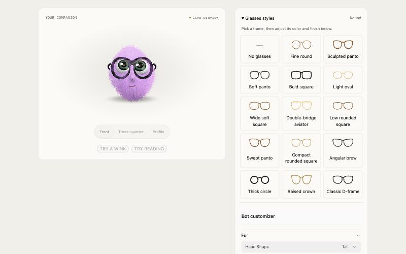

# Companion Bot

A furry 3D companion for your web app. Drop in one `<companion-bot>` element and you get a plush bot that blinks, glances at the pointer, fidgets, hops when clicked, and shows your app's mood: busy while it works, asleep while it's paused. Your users can restyle it in a customizer with presets, fur, face, nose, eyes and 14 glasses frames.

**[Try the live demo](https://adamperlis.github.io/adam-plugins/plugins/companion-bot/examples/companion-bot-demo.html)**: switch moods, poke the bot, flip light and dark, and build your own in the customizer.



## Install

**Claude Code**

```bash
claude plugin marketplace add adamperlis/adam-plugins
claude plugin install companion-bot@adam-plugins
```

**Codex**

```bash
codex plugin marketplace add adamperlis/adam-plugins
```

Then install `companion-bot` from the Plugins Directory.

Then ask for it:

| Host | Example |
|---|---|
| Claude Code | `/companion-bot add the bot to our header and empty states, and a customizer in Settings` |
| Codex | `$companion-bot add the bot to our header and empty states, and a customizer in Settings` |

The skill copies the component into your project's static files, places bots where they help, drives the mood from your app's real state, and mounts the customizer. It also covers React/Next.js typing, your brand's default look, and keeping the look on your server.

## Without the plugin

The component is one folder of plain ES modules with Three.js and DialKit vendored inside: no build step, no import map, no npm install. Copy [`skills/companion-bot/assets/companion-bot/`](skills/companion-bot/assets/companion-bot/) into your static files, then:

```html
<script type="module" src="/companion-bot/companion-bot.js"></script>
<companion-bot size="96" name="hello"></companion-bot>

<script type="module">
  companionBot.mood('working');   // 'idle' | 'working' | 'sleeping'

  import { mountCustomizer } from '/companion-bot/customizer.js';
  mountCustomizer(document.querySelector('#settings'));
</script>
```

[`SKILL.md`](skills/companion-bot/SKILL.md) documents every attribute, event and option.

## What's inside

| | |
|---|---|
| `companion-bot.js` | The entry. Loads the look, starts the 3D bot, and falls back on its own. |
| `bot3d.js` | Three.js on WebGPU (WebGL 2 where there's no WebGPU). Shell fur, up to 44 layers; on WebGPU each hair is a spring simulated on the GPU, so the fur lags behind hops and parts under your pointer. |
| `bot2d.js` | The same character in one WebGL 1 fragment shader, for older devices. |
| `appearance.js` | The schema, presets, glasses catalog, and the applied look (localStorage by default). |
| `customizer.js` + `.css` | The customizer, mounted into any element, themable with `--cb-*` variables. |

It honors `prefers-reduced-motion`, follows your page's light or dark theme, and shares one renderer between every bot on the page.

## License

MIT. Bundles Three.js r186 (MIT) and DialKit 2.1.0 by Josh Puckett (MIT); their licenses are in `vendor/`.
