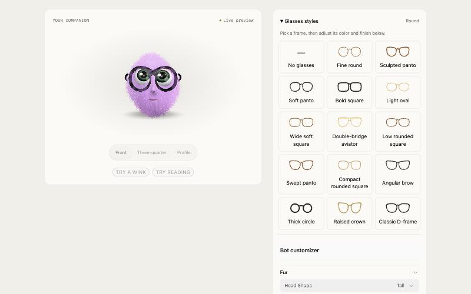

# Companion Bot

A small plush bot that lives in an app's interface. It glances at the pointer, blinks, fidgets and hops when clicked. It looks busy while the app works and dozes while it sleeps. Users can restyle it: fur color and length, head shape, beard, nose, eyes, and glasses, with presets they can save.

It came from a support desk, where it sits in the header, keeps the empty states company and naps when the autopilot is paused. The whole thing is plain ES modules in one folder, with Three.js and DialKit vendored inside it.



`assets/companion-bot/` is the complete, working component. Copy it into the project; don't rebuild it.

## When it fits

- An app that wants some warmth: a header mark, a friend in empty states ("Nothing here"), a reaction to finished work, a settings page users can play with.
- Apps with a clear state the bot can mirror: busy (`working`), paused, offline or after hours (`sleeping`), everything else (`idle`).

It is a character, not an icon. Don't put it in dense data tables, next to every list row, or anywhere it would compete with content. One to three bots on screen is plenty; the header bot at 32–40 px and an empty-state bot at 72–160 px is the usual pairing.

## 1. Copy the folder

Copy `assets/companion-bot/` from this skill's folder into the project's static files, so it's served as-is at a stable URL:

| Project | Put it at | Served from |
|---|---|---|
| Plain HTML | `companion-bot/` next to the page | `./companion-bot/` |
| Next.js, Vite, Astro, Remix | `public/companion-bot/` | `/companion-bot/` |
| SvelteKit | `static/companion-bot/` | `/companion-bot/` |
| Rails, Django, Laravel | the app's public/static folder | that folder's URL |

Keep it out of the bundler. The files import each other by relative path, load the 3D renderer lazily and fall back on their own; bundling them gains nothing. Copy the whole folder, including `vendor/`: `bot3d.js` imports the vendored Three.js r186 by relative path, so the page needs no import map and won't pick up another copy of Three by accident. The folder is about 3 MB on disk. A page with a bot loads about 1.3 MB of Three.js (uncompressed; much less over gzip or brotli), and the customizer adds DialKit (about 0.4 MB) only where it's mounted.

## 2. Load it once and place bots

```html
<script type="module" src="/companion-bot/companion-bot.js"></script>

<companion-bot size="36" name="header" aria-hidden="true"></companion-bot>
<companion-bot size="120" name="empty-inbox" gaze="down" aria-hidden="true"></companion-bot>
```

| Attribute | What it does |
|---|---|
| `size` | Width and height in CSS pixels (default 32). The bot draws at the device's pixel ratio. |
| `name` | Keeps a bot's blinks, glances and fur where they were when the element is removed and added again, as frameworks do on re-render. Give every bot that can re-render a stable name. |
| `gaze` | `left`, `right` or `down`: where it tends to look when idle, toward the content beside it. |
| `hop` | Hops once when it appears. Good for "all done" moments and toasts. |
| `view` | `front`, `threeQuarter` or `profile` (3D only). |
| `preview` | Shows the customizer's unapplied preview instead of the applied look. The customizer's own bot uses this. |
| `fallback` | Image URL for browsers with no WebGL at all (default `bot-still.png`). |

Decorative bots get `aria-hidden="true"`. A bot that stands for something on its own gets `aria-label`.

**React and Next.js.** Custom elements work in JSX as written. Put the script tag in the root layout's `<head>` (`<script type="module" src="/companion-bot/companion-bot.js" async />`). Write boolean attributes as `hop=""`, not `hop`. In TypeScript, declare the element once:

```ts
// companion-bot.d.ts
import type { DetailedHTMLProps, HTMLAttributes } from 'react';
type BotProps = DetailedHTMLProps<HTMLAttributes<HTMLElement>, HTMLElement> & {
  size?: number | string; name?: string; gaze?: 'left' | 'right' | 'down';
  view?: 'front' | 'threeQuarter' | 'profile'; hop?: ''; preview?: ''; fallback?: string;
};
declare module 'react' { namespace JSX { interface IntrinsicElements { 'companion-bot': BotProps } } }
```

Vue needs `compilerOptions.isCustomElement: tag => tag === 'companion-bot'`; Svelte and Astro need nothing.

## 3. Give it the app's mood

```js
window.companionBot.mood('working');   // lids lowered, eyes on the work; while something runs
window.companionBot.mood('sleeping');  // eyes closed, slow breathing; paused, offline, after hours
window.companionBot.mood('idle');      // looks around, follows the pointer, fidgets
```

Mood is page-wide: every bot shares it. Calling it before the bot has loaded is fine; the page's latest mood is kept until it's ready. Drive it from real state (a request in flight, a paused job, `navigator.onLine`), not a timer. The customizer's preview bot stays awake whatever the mood.

Also on `window.companionBot` once `companionbotready` fires on `window`:

- `express(element, 'wink' | 'examine' | 'neutral')`: a wink, or peering down over its glasses.
- `setView(element, view, { animate })`: turns on a spring (3D only).
- `renderer`: `'webgpu'`, `'webgl'`, `'flat'` or `'still'`.

## 4. Add the customizer (optional)

```js
import { mountCustomizer } from '/companion-bot/customizer.js';
const customizer = mountCustomizer(document.querySelector('#bot-settings'), {
  title: 'Your companion', subtitle: 'Make it your own.', applyLabel: 'Apply',
});
// When that view goes away for good:
customizer.destroy();
```

It loads its own CSS, builds its markup inside the element you give it, and works on phones. In React, mount it in a `useEffect` and return `() => customizer.destroy()`. Its colors are `--cb-*` variables on `.cb-customizer` (see the top of `customizer.css`): set those in the app's CSS to match the brand rather than editing the file. Its type inherits the page's font.

**Apply** sets the look for every bot on the page and saves it in this browser. **Save preset** stores the preview, with a 192 px thumbnail, in this browser's list (up to 24).

## 5. Make it the brand's bot

Set this before the script tag, or before the module first loads:

```html
<script>
  window.companionBotConfig = {
    storageKey: 'acme.bot',   // localStorage prefix, so two apps on one domain don't share a bot
    defaults: { fur: { color: '#2f6bff', length: 0.36, beardStyle: 'none' }, glasses: { style: 'round' } },
  };
</script>
```

`defaults` is partial and is the look a new visitor sees, and what Reset returns to. The keys are in `schema` in `appearance.js`; each value is checked and clamped there, so a bad value falls back instead of breaking the bot. To change the built-in presets, edit `presets` in `appearance.js`. Each needs a 384 × 384 PNG in `presets/`; the simplest way is to dial the look in the customizer, save it, and screenshot the preview.

Light and dark: the bot's lighting follows `<html data-theme="dark|light">`, then `class="dark|light"` on `<html>` (Tailwind, shadcn), then the system setting, and switches live.

## 6. Keep the look on a server (optional)

By default the look and saved presets live in this browser's localStorage. To keep them with the user's account instead:

```js
window.companionBotConfig = { persist: false };            // before companion-bot.js loads
const bot = window.companionBotAppearance;                 // after it loads
bot.set(await fetch('/api/bot-look').then(r => r.json())); // show the saved look
addEventListener('companionbotappearancechange', e =>
  fetch('/api/bot-look', { method: 'PUT', body: JSON.stringify(e.detail), headers: { 'content-type': 'application/json' } }));
// Saved presets, if you keep them too: bot.loadPresets(list) and the companionbotpresetschange event.
```

Validate on the server too: the client clamps values, but a server should only store an object with the four groups (`fur`, `face`, `glasses`, `personality`) of short strings, numbers and booleans, and cap the size. A saved preset's thumbnail is a PNG data URL of up to about 180 KB.

If the same user can change the look on two devices, decide what happens when one was offline: the newer edit wins, or the server always wins. Keep the browser copy (`persist: true`) and use the server as the source of truth if the bot should appear before your API answers, for example on a sign-in page.

## How it works (for changes)

- `companion-bot.js` imports `appearance.js`, then tries `bot3d.js`. If that throws (no WebGPU or WebGL 2, or a module failed to load), it imports `bot2d.js`.
- `bot3d.js`: one shared Three.js renderer poses the model for each `<companion-bot>` in turn and copies the frame onto that bot's own canvas. The fur is shell fur, up to 44 layers. On WebGPU, each hair root is a spring simulated in a compute pass, so hair lags behind hops and turns and parts under the pointer. On WebGL 2 the whole pelt swings on one spring. A bot inside a hidden view (`display: none`) isn't drawn.
- `bot2d.js`: the same character in a single WebGL 1 fragment shader, front view only.
- `prefers-reduced-motion` is honored: bots hold a still pose, and expressions show a still pose instead of animating.
- Events on `window`: `companionbotready`, `companionbotappearancechange`, `companionbotpreviewchange`, `companionbotpresetschange`, `companionbotthemechange`.

Don't edit `vendor/`. Three.js's two bare imports (`three/webgpu` in `three.tsl.min.js` and `three` in `RoomEnvironment.js`) were changed to relative paths, so the folder runs without an import map. Upgrading Three means repeating that change.

## Check it

Open the page and confirm:

1. The console has no errors, and `companionBot.renderer` is `webgpu` in browsers with WebGPU, or `webgl` elsewhere.
2. Clicking a bot makes it hop. With the pointer near it, its eyes follow.
3. `companionBot.mood('sleeping')` closes its eyes, and `'idle'` wakes it.
4. Switch the page to dark: the rim light gets stronger and the customizer follows.
5. In the customizer: pick a preset, Apply, reload — the look stays. Save a preset and reload — it's listed under Your presets.
6. With reduced motion on (DevTools → Rendering), the bots hold still.
7. At 375 px wide, the customizer is one column with no sideways scroll.

## License

The component is MIT. It bundles Three.js r186 (MIT, © three.js authors) and DialKit 2.1.0 (MIT, © Josh Puckett); their licenses are in `vendor/`.
